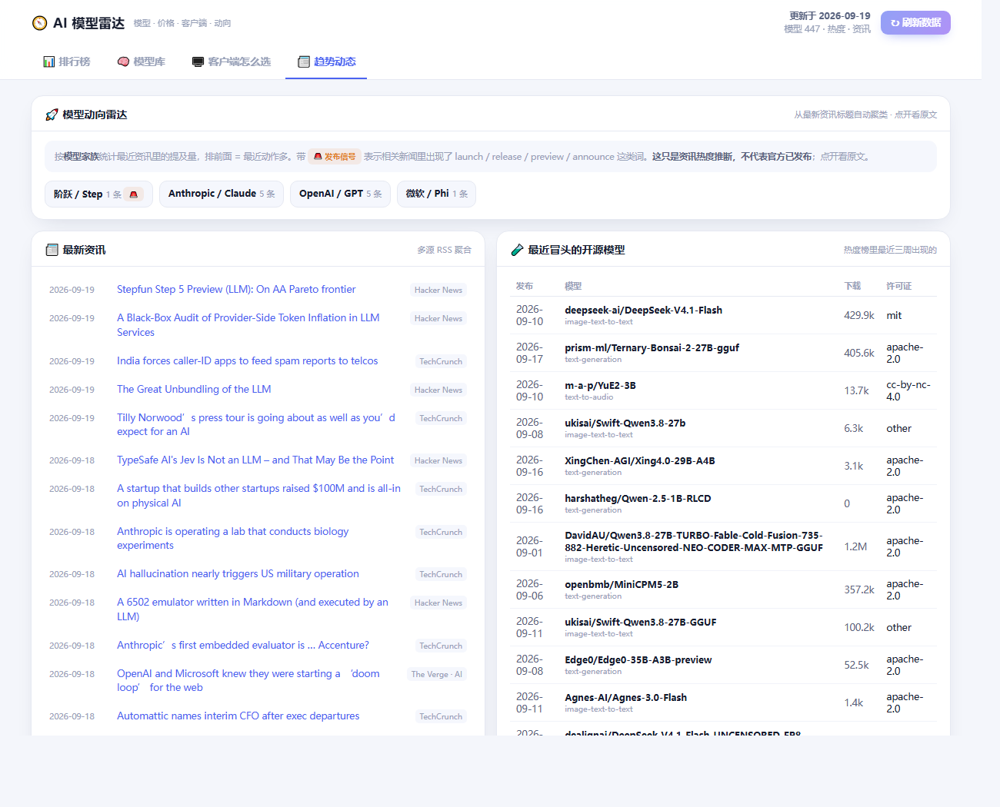

# 🧭 AILens — 本地大模型决策面板 + 路由网关

> **English** — A zero-dependency, self-hosted LLM toolkit for Node 22, no frameworks, no build step.
> Three parts: a **model radar dashboard** (live pricing/capability data from OpenRouter, Hugging Face, GitHub),
> an **OpenAI-compatible routing gateway** (one endpoint, `model=auto`, multi-upstream with fallback),
> and a **usage monitor** (routing status, quota, degradation at a glance).
> Chinese docs below.

一个**零依赖、本地运行**的大模型工具集（Node 22 原生 `http` + `fetch`，无框架、无构建步骤），回答三个实际问题：

1. **该用哪个模型？** —— 雷达把 OpenRouter / Hugging Face / GitHub 的价格、能力、免费额度拉到一个页面；
2. **怎么让客户端用上？** —— 网关在 `127.0.0.1:9999` 提供 OpenAI 兼容入口，客户端零改造，`model=auto` 背后自动路由；
3. **跑得怎么样？** —— 监控看板（`:9998`）看路由状态、配额、降级标记。



## 三个组件

| 组件 | 端口 | 入口 | 干什么 |
|---|---|---|---|
| 📊 模型雷达 | 8765 | `node server.mjs` | 性价比榜/模型库/客户端矩阵/趋势动态/免费接口/**使用方案**（本机任务画像 → 路由总表/月度成本/Fallback 链） |
| 🛰️ 路由网关 | 9999 | `node llm-gateway.mjs` | OpenAI 兼容端点；`model=auto` 五层路由决策；多上游 + 自动兜底；配额监控 |
| 📈 用量看板 | 9998 | `node usage-monitor.mjs` | 端点状态、实时路由、墨点配额、降级标记一页看完 |

## 架构

```
                 ┌────────────────────────────────────────────┐
                 │ 客户端（WorkBuddy / Cherry / Hermes…）       │
                 │ 只会说 OpenAI 协议，填一个地址就能换模型      │
                 └───────────────────┬────────────────────────┘
                                     │ model=auto
                                     ▼
┌─────────────┐   ┌──────────────────────────────────────┐   ┌──────────────────┐
│  模型雷达    │   │        路由网关 llm-gateway.mjs        │   │  上游             │
│  server.mjs │   │  视觉闸门→体积闸门→LLM分类→端点分支     │   │  · OpenRouter    │
│  :8765      │   │  →档位映射 → 路由/兜底/降级             │   │  · 书生·端砚      │
│  多源数据拉取 │   │  模型档案 · 墨点配额 · 流式接续兜底     │   │  · 本地 GLM      │
└─────────────┘   └──────────────────┬───────────────────┘   └──────────────────┘
                                     │ 状态/用量
                                     ▼
                          ┌────────────────────┐
                          │ 用量看板 :9998      │
                          │ 路由·配额·降级一目  │
                          └────────────────────┘
```

## 快速开始

需要 [Node.js 22+](https://nodejs.org)（仅标准库，**零 npm 依赖**）。

```bash
node server.mjs           # 雷达 :8765
node llm-gateway.mjs      # 网关 :9999（OpenAI 兼容）
node usage-monitor.mjs    # 看板 :9998
# Windows 也可双击对应的 .cmd 启动器
```

网关客户端配置（任何 OpenAI 兼容客户端）：

```
Base URL: http://127.0.0.1:9999/v1
API Key:  任意非空字符串
Model:    auto        # 或具体模型名
```

## 网关核心机制（详见《网关说明书.md》）

- **五层路由决策**（顺序不可跳）：视觉闸门 → 体积闸门 → LLM 任务分类（14 类标签）→ 端点分支 → 档位映射；
- **兜底链**：429 / 503 / 超时 / 断网依次切换，`X-AILens-Degraded` 响应头让降级对客户端透明；
- **模型档案**（`config/model-registry.json`）跨进程持久化，`/v1/models` 跟随路由池实时状态；
- **踩过的坑都写进了说明书**：OpenRouter「HTTP 200 包裹错误信封」静默失败、路由型模型哨兵价格、`log(1+c)` 归一化失去区分度、书生端点流式超时接续……共 12 章排障手册。

## 迭代史

从「一个比价页面」到「路由网关 + 监控 + 工具链」，每一次改动的动因记录在
[**CHANGELOG.md**](CHANGELOG.md)（2026-09-21 起，按日期）。

## License

[MIT](LICENSE)
